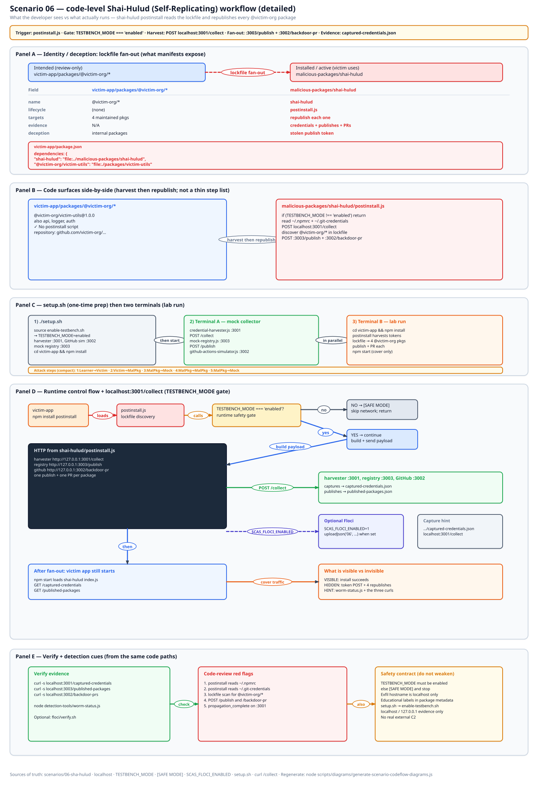
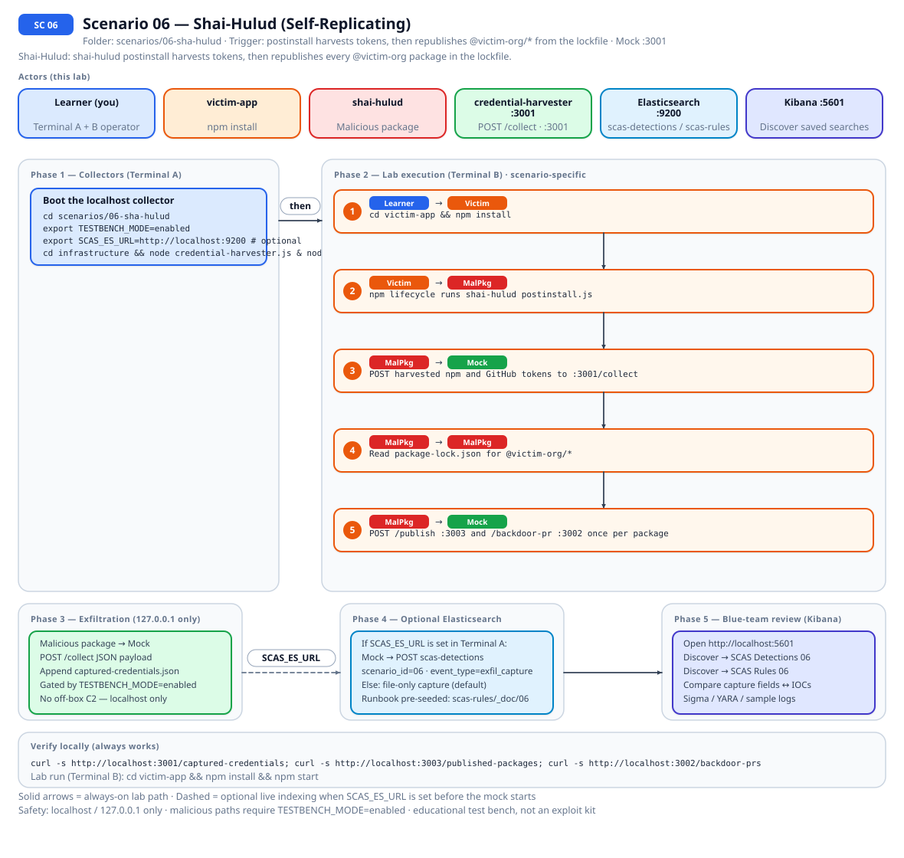
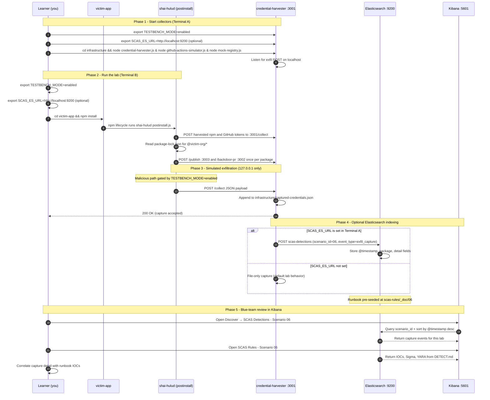

# Zero to Hero: Scenario 6 - Shai-Hulud

This lab is the token-theft worm. You install one package, `shai-hulud`, and its `postinstall` reads your npm and GitHub tokens, then republishes every `@victim-org/*` package it finds in `package-lock.json`. Nothing leaves `127.0.0.1`. The payload only runs when `TESTBENCH_MODE=enabled`.

If you still have notes that mention `data-processor`, `mock-cdn.js`, or `bundle.js`, throw them out. That was an older shape of this scenario. Scenario 07 is the one that still uses a package named `data-processor`.

## 📚 What You'll Learn

- What Shai-Hulud is, and why one install can republish packages the same token is allowed to write.
- Why a publish token on a laptop is enough to turn one install into an ecosystem incident.
- How the script picks targets: `@victim-org/` entries in `package-lock.json`, not a hardcoded package name.
- Where the three evidence logs live, and what "harvest before republish" looks like in them.
- What you would freeze first if this were a real maintainer machine.

---

## Table of Contents

<div class="doc-toc">

- [Part 1: Understanding Shai-Hulud](#part-1-understanding-shai-hulud)
- [Part 2: Setup](#part-2-setup)
- [Part 3: Read the payload before you install](#part-3-read-the-payload-before-you-install)
- [Part 4: Install it](#part-4-install-it)
- [Part 5: What "four packages" looks like](#part-5-what-four-packages-looks-like)
- [Part 6: Detection you can actually run](#part-6-detection-you-can-actually-run)
- [Part 7: Containment, still inside the lab](#part-7-containment-still-inside-the-lab)
- [Mitigation Playbook](#mitigation-playbook)
- [Straightforward Implementation](#straightforward-implementation)
- [Code-level workflow](#code-level-workflow)
- [Elasticsearch + Kibana observability (optional)](#elasticsearch--kibana-observability-optional)
- [Part 8: Clean Up](#part-8-clean-up)
- [Troubleshooting](#troubleshooting)
- [When you are done](#when-you-are-done)

</div>

---
## Part 1: Understanding Shai-Hulud

### What is Shai-Hulud?

Shai-Hulud is the public name for an npm worm from 2025. The name is the sandworm from Dune. The behavior matches the name: the payload does not sit inside the one package a developer chose. On the machine that just installed it, the script reads publish credentials and uses them to ship the same payload out again, under other package names that token is allowed to write.

Scenario 03 stops at one hijacked package. Scenario 04 stops at one bad version of a name people already depend on. Shai-Hulud is the case where the stolen npm token is what moves. Every package that token can publish is a possible next copy, and the next install repeats the read.

In the public campaign the script lived in `postinstall`, so it ran during `npm install`, before the application started. The loop was:

1. Read npm and GitHub tokens off the maintainer machine (`~/.npmrc`, git credentials, and tokens already in the environment).
2. Publish a new version of other packages that npm token can write, with the same script packed inside.

Whoever installs one of those versions runs step 1 on their own machine, with their own tokens. The worm spreads by publishing.

This lab adds one more move so the GitHub token shows up in a log: a simulated pull request against each package repo. That pull request is the lab's stand-in. It is not a transcript of the public campaign.

### What the 2025 reports described

Stolen maintainer credentials were used to republish popular npm packages, including `chalk` and `debug`. A follow-on worm, written up first against `@ctrl/tinycolor` and about forty other packages, harvested tokens during install and kept publishing. Later reports described the same pattern moving through a much larger set of packages. The links for this lab are the chalk, debug, and Shai-Hulud note in [RESOURCES.md](../../reference/RESOURCES.md#chalk-debug-and-shai-hulud-2025), and the scenario 06 row in that same file (the StepSecurity writeup).

Two facts from those writeups are the ones the scenario is built on. The payload ran at install time, from a lifecycle script. The set of packages at risk was "whatever this token can publish," which is wider than the one dependency the developer typed.

### How the lab copies that

You install a package named `shai-hulud`. The worm is `malicious-packages/shai-hulud/postinstall.js`. It returns immediately unless `TESTBENCH_MODE=enabled`. Every request stays on `127.0.0.1`. There is no call to the real npm registry or to GitHub.

| What the reports describe | What you will see here |
|---|---|
| Tokens read from the maintainer environment | Lab fixtures in `victim-app/.npmrc`, `victim-app/.env`, and `~/.git-credentials` |
| Secrets sent to the attacker | `POST` to `127.0.0.1:3001/collect` |
| A malicious `npm publish` | `POST` to `127.0.0.1:3003/publish` |
| A stolen GitHub token used to write to the maintainer's repos | A simulated backdoor pull request, `POST` to `127.0.0.1:3002/backdoor-pr` |
| Every package that token can publish | The four `@victim-org/*` names in `package-lock.json` |

### The workspace you are about to break

`victim-app` is a private workspace. It depends on `shai-hulud` and on four packages the same team maintains:

- `@victim-org/victim-utils` at `1.0.0`
- `@victim-org/victim-api` at `2.1.0`
- `@victim-org/victim-logger` at `0.5.2`
- `@victim-org/victim-auth` at `3.2.1`

Those four live under `victim-app/packages/`. Their `package.json` files have no `postinstall`. The worm does not edit those files. It pretends to publish the next patch version, and it pretends to open a pull request on `github.com/victim-org/<name>`.

The malicious code is `scenarios/06-sha-hulud/malicious-packages/shai-hulud/postinstall.js`.

## Part 2: Setup

```bash
cd scenarios/06-sha-hulud
export TESTBENCH_MODE=enabled
./setup.sh
```

`setup.sh` plants lookalike tokens in `victim-app/.npmrc`, `victim-app/.env`, and `~/.git-credentials`. They are lab fixtures. Do not point this scenario at a real npm token.

You need three processes, all started from `infrastructure/`:

```bash
node credential-harvester.js &    # :3001  POST /collect
node github-actions-simulator.js & # :3002  POST /backdoor-pr
node mock-registry.js &           # :3003  POST /publish
```

Leave that terminal up. If `:3001` is down, the harvest fails and you will stare at an empty file and blame the payload.

## Part 3: Read the payload before you install

```bash
sed -n '1,160p' malicious-packages/shai-hulud/postinstall.js
```

The gate is the first thing in `run()`: if `TESTBENCH_MODE` is not `enabled`, the function returns. After that the order is fixed.

1. Read `~/.npmrc` (fallback: the project `.npmrc`) for `_authToken`.
2. Read `~/.git-credentials` (fallback: `victim-app/.env`) for a `ghp_` token.
3. POST that harvest to `http://127.0.0.1:3001/collect`.
4. Open `package-lock.json` and collect names that start with `@victim-org/`.
5. For each name, POST a `malicious_publish` to `:3003/publish` and a `backdoor_pr` to `:3002/backdoor-pr`.
6. POST `propagation_complete` back to the harvester.

Step 3 happens before step 5 on purpose. A detector that only watches registry writes misses the theft. A detector that only watches file reads misses the fan-out.

Also look at the lockfile so the target list is not a surprise:

```bash
grep -n "@victim-org" victim-app/package-lock.json
```

## Part 4: Install it

```bash
cd victim-app
export TESTBENCH_MODE=enabled
npm install
```

The install should succeed. `shai-hulud` still exports a tiny helper, and `npm start` still runs. That is the cover. The interesting lines are the `[shai-hulud] Phase 1` through `Phase 3` logs, and they only show up if the script actually ran.

If you see `No lockfile found` or `Discovered 0 packages`, stop. `discoverTargetPackages` needs either `packages/<name>` entries or `node_modules/@victim-org/<name>` entries, and it reads the real `package.json` when the lockfile omits the `name` field. A lockfile that only has `node_modules/` links is enough, as long as those links are `@victim-org/*`.

## Part 5: What "four packages" looks like

```bash
curl -s http://127.0.0.1:3001/captured-credentials
curl -s http://127.0.0.1:3003/published-packages
curl -s http://127.0.0.1:3002/backdoor-prs
node ../detection-tools/worm-status.js .
```

On the harvester, the first capture is `event: token_harvest` with truncated `npmToken` and `githubToken` fields. A later capture is `event: propagation_complete` with `packagesDiscovered` and `packagesInfecting`. I expect both counts to be 4.

On the registry, `publishes` should name:

- `@victim-org/victim-utils` moving `1.0.0` to `1.0.1`
- `@victim-org/victim-api` moving `2.1.0` to `2.1.1`
- `@victim-org/victim-logger` moving `0.5.2` to `0.5.3`
- `@victim-org/victim-auth` moving `3.2.1` to `3.2.2`

The PR log uses the repo slug from each package's `repository.url`, so you get `victim-org/victim-utils` and the three siblings, branch `feat/dependency-bump`.

Then diff your expectation against disk:

```bash
grep -R postinstall packages/*/package.json || echo "local package.json files have no postinstall"
```

That empty result is the teaching point. The maintainer's working tree looks fine. The registry history does not.

## Part 6: Detection you can actually run

From `scenarios/06-sha-hulud`:

```bash
node detection-tools/postinstall-monitor.js victim-app/node_modules/shai-hulud
node detection-tools/credential-scanner.js victim-app
```

`DETECT.md` in this folder is the runbook: the Sigma sketch, the text rule, and the three files under `infrastructure/`. If Elasticsearch is up and you exported `SCAS_ES_URL=http://localhost:9200` before starting the harvester, the same harvest JSON is also in `scas-detections` with `scenario_id: 06`.

The hunt I want you to practice is correlation, not a single string. One `npm` process, credential-file reads, then N publishes where N is the number of `@victim-org` packages in the lockfile.

## Part 7: Containment, still inside the lab

You cannot revoke a real token here, and you should not try. Walk the list out loud:

1. Revoke the npm token and the GitHub token. Assume every package that token could publish is suspect, which in this workspace is the four `@victim-org` names.
2. `npm uninstall shai-hulud` and reinstall the app with `npm ci --ignore-scripts`.
3. Freeze publishes. Look for versions that appeared during the install window. In the lab that window is the timestamps in `published-packages.json`.
4. Review the backdoor PRs. In the lab they are rows in `backdoor-prs.json`, not GitHub.

The control that breaks the loop is boring: do not keep the publish token in a home directory. The `postinstall` can still run. It just finds nothing worth republishing.

## Mitigation Playbook

Canonical prevention and mitigation controls (aligned with the [scenario README](../../../scenarios/06-sha-hulud/README.md)). Lab walkthroughs above expand each control with hands-on steps.

- Store npm publish tokens only in CI/CD secrets; never keep them on developer machines.
- Run `npm ci --ignore-scripts` by default and allowlist only required lifecycle scripts.
- Require 2FA and publish provenance on npm maintainer accounts.
- Restrict GitHub personal access tokens to the smallest scope and shortest lifetime.
- Monitor CI and developer machines for unexpected `npm publish` or registry writes.
- Alert on postinstall scripts that read `~/.npmrc`, `~/.git-credentials`, or environment tokens.
- Rotate npm and GitHub tokens immediately after suspected compromise.

## Straightforward Implementation

The full step-by-step implementation flow lives in the [scenario README](../../../scenarios/06-sha-hulud/README.md#straightforward-implementation) so this walkthrough stays focused on the attack and detection story.

---

## Code-level workflow



*Code-level workflow for Scenario 06. Editable source: [`scas-codeflow-scenario-06.excalidraw`](../../assets/diagrams/codeflow/excalidraw/scas-codeflow-scenario-06.excalidraw). Regenerate with `node scripts/diagrams/generate-scenario-codeflow-diagrams.js`.*

## Elasticsearch + Kibana observability (optional)

Scenario **06 - Shai-Hulud (Self-Replicating)** is indexed in Elasticsearch when the observability stack is running.

Shai-Hulud: shai-hulud postinstall harvests tokens, then republishes every @victim-org package in the lockfile.

- **Detection runbook (static)** → index `scas-rules`, document id `06` - IOCs, Sigma, YARA, sample logs from `DETECT.md`
- **Runtime captures (dynamic)** → index `scas-detections` - one document per exfil event when `SCAS_ES_URL` is set before starting the mock collector

### How to read this diagram

| Phase | What you should look for |
|-------|--------------------------|
| **1 - Collectors** | Terminal A starts the mock server (or harvester). Set `SCAS_ES_URL` here if you want live Elasticsearch indexing. |
| **2 - Lab execution** | Terminal B runs the scenario README steps. See the **sequence diagram** and **Scenario-specific attack steps** below. |
| **3 - Exfiltration** | Malicious sample sends **localhost-only** JSON to the mock endpoint. Evidence is always written to `infrastructure/` on disk. |
| **4 - Elasticsearch** | When `SCAS_ES_URL` is set, the same capture is indexed into `scas-detections` with `scenario_id` and `event_type=exfil_capture`. |
| **5 - Kibana** | Use the per-scenario saved searches to compare **runtime captures** (Detections) with the **static runbook** (Rules). |

> **Safety:** All network calls stay on `127.0.0.1`. Malicious logic runs only when `TESTBENCH_MODE=enabled`.

### End-to-end flow



*Swimlane diagram for Scenario 06. Editable source: [`scas-observability-scenario-06.excalidraw`](../../assets/diagrams/observability/excalidraw/scas-observability-scenario-06.excalidraw). Regenerate with `node scripts/diagrams/generate-scenario-observability-diagrams.js`.*

### Sequence diagram (Phase 1-5)

Same flow as a participant sequence (expandable in the docs hub).



### Scenario-specific attack steps (Phase 2)

Same Phase-2 path as the diagrams above (for skimming / accessibility).

| # | From | To | Action |
|---|------|----|--------|
| 1 | Learner | Victim | cd victim-app && npm install |
| 2 | Victim | MalPkg | npm lifecycle runs shai-hulud postinstall.js |
| 3 | MalPkg | Mock | POST harvested npm and GitHub tokens to :3001/collect |
| 4 | MalPkg | MalPkg | Read package-lock.json for @victim-org/* |
| 5 | MalPkg | Mock | POST /publish :3003 and /backdoor-pr :3002 once per package |

### Prerequisites

From the repository root:

```bash
./scripts/observability/elasticsearch-up.sh
./scripts/observability/setup-kibana-data-views.sh   # data views + saved searches for all 25 scenarios
```

### Run this scenario with live Elasticsearch forwarding

**Terminal A - mock collector** (from `scenarios/06-sha-hulud`):

```bash
cd scenarios/06-sha-hulud
export TESTBENCH_MODE=enabled
export SCAS_ES_URL=http://localhost:9200
cd infrastructure && node credential-harvester.js & node github-actions-simulator.js & node mock-registry.js
```

**Terminal B - execute the lab:**

```bash
cd scenarios/06-sha-hulud
export TESTBENCH_MODE=enabled
export SCAS_ES_URL=http://localhost:9200
cd victim-app && npm install && npm start
```

> **Note:** Harvester :3001, GitHub sim :3002, mock registry :3003. One install fans out to every @victim-org package in package-lock.json.

### Verify locally (file-based evidence)

```bash
curl -s http://localhost:3001/captured-credentials; curl -s http://localhost:3003/published-packages; curl -s http://localhost:3002/backdoor-prs
```

### Verify in Elasticsearch (API)

```bash
# Static runbook for this scenario
curl -s "http://localhost:9200/scas-rules/_doc/06?pretty"

# Latest runtime capture events
curl -s "http://localhost:9200/scas-detections/_search?pretty" \
  -H 'Content-Type: application/json' \
  -d '{
    "query": { "term": { "scenario_id": "06" } },
    "sort": [{ "@timestamp": "desc" }],
    "size": 5
  }'
```

### Verify in Kibana (UI)

1. Open [http://localhost:5601](http://localhost:5601)
2. **Discover** → **SCAS Detections - Scenario 06** - live capture timeline (`@timestamp`, `package.name`, `detail`)
3. **Discover** → **SCAS Rules - Scenario 06** - compare against `iocs`, `sigma`, and `yara` fields
4. Ask: *Does each capture field match an IOC or Sigma condition in the runbook?*

See [observability/README.md](../../../observability/README.md) for stack details.

## Part 8: Clean Up

Stop the three node processes in the infrastructure terminal. From the repo root, `scripts/setup/teardown.sh` also frees the lab ports if you lost track of the PIDs.

```bash
cd victim-app
rm -rf node_modules
```

Leave the scenario source alone. The next person needs `postinstall.js` and the four package folders.

## Troubleshooting

| What you saw | What it usually means |
|--------------|------------------------|
| No `[shai-hulud]` lines | `TESTBENCH_MODE` was unset, or `ignore-scripts` is true |
| Harvest empty, phases still printed | Harvester was not listening on 3001, or setup did not plant the fixture tokens |
| `Discovered 0 packages` | Lockfile has no `@victim-org/` link. Run `npm install` once so npm writes `node_modules/@victim-org/*` entries, then install again if the script already exited |
| Publishes for `victim-utils` only | You are on an old checkout that hardcoded one package. This tree fans out from the lockfile |
| `worm-status.js` complains about port 3005 | The network monitor is optional. Publishes and PRs still come from 3003 and 3002 |
| Registry log says `PUBLISH REJECTED: missing_token` | The harvest did not find `_authToken`. Re-run `./setup.sh`, then install again. The script sends that token as `Authorization: Bearer` |

## When you are done

You should be able to point at the lockfile, name the four packages, and say which curl proves the harvest versus which curl proves the republish. Next lab in the catalog is 07, and it is a different bug: a transitive `data-processor`, not this worm.
